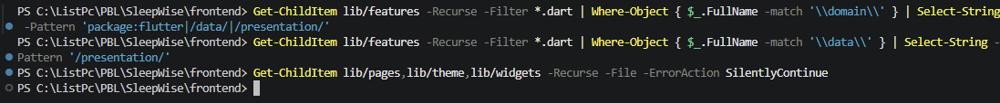

# SleepWise Frontend

Aplikasi Flutter untuk memantau pola tidur, membuat prediksi kualitas tidur,
melihat riwayat evaluasi, dan menampilkan statistik tidur.

## Menjalankan Project

Jalankan perintah berikut dari folder `frontend`:

```powershell
flutter pub get
flutter run
```

## Struktur Clean Architecture

```text
lib/
	core/
		navigation/       # Route aplikasi dan shell navigasi utama
		theme/             # Warna, spacing, radius, dan ThemeData
		widgets/           # Widget reusable lintas fitur
	features/
		auth/
			presentation/   # Halaman login dan register
		home/
			presentation/   # Halaman dashboard
		history/
			data/            # Sumber data riwayat lokal
			domain/          # Entity, kontrak repository, dan use case riwayat
			presentation/    # Halaman riwayat dan tampilan kartu
		prediction/
			data/            # Implementasi repository prediksi lokal
			domain/          # Input, hasil, kontrak repository, dan use case
			presentation/    # Halaman dan widget input prediksi
		profile/
			presentation/   # Halaman profil dan logout
		statistics/
			presentation/   # Halaman dan kartu statistik
```

## Fungsi Tiap Layer

### `core`

Berisi kode umum yang digunakan banyak fitur. Contohnya route aplikasi,
tema warna, `MainShell`, dan widget reusable. Kode di sini tidak boleh berisi
aturan bisnis khusus satu fitur.

### `features`

Setiap folder di dalam `features` mewakili satu kemampuan utama aplikasi.
Contohnya `auth` untuk autentikasi, `history` untuk riwayat, dan `prediction`
untuk prediksi kualitas tidur.

### `data`

Mengatur cara aplikasi mengambil atau menyimpan data. Implementasinya dapat
berupa repository lokal, SQLite, atau API. Layer ini mengimplementasikan
kontrak repository yang didefinisikan oleh `domain`.

### `domain`

Berisi aturan bisnis inti yang tidak bergantung pada Flutter UI. Isinya:

- `entities`: bentuk data bisnis seperti `SleepRecord` atau `PredictionInput`.
- `repositories`: kontrak yang harus diimplementasikan oleh layer `data`.
- `usecases`: satu operasi bisnis yang dapat dipanggil oleh presentation.

### `presentation`

Berisi halaman, state, dan widget yang berhubungan dengan tampilan. Layer ini
boleh menggunakan `domain` dan `core`, tetapi tidak seharusnya berisi detail
penyimpanan data atau query API secara langsung.

### `main.dart`

Merupakan titik awal aplikasi dan composition root. File ini menjalankan
aplikasi, memasang theme, dan mendaftarkan route melalui `AppRoutes`.

## Arah Dependency

Aturan dependency project:

```text
presentation -> domain -> tidak bergantung pada UI
data        -> domain
core        -> komponen bersama
main.dart   -> menghubungkan seluruh aplikasi
```

`domain` tidak boleh mengimpor `package:flutter`. Repository dan use case
harus tetap dapat diuji tanpa menjalankan tampilan Flutter.

## Pemeriksaan Clean Architecture

Jalankan dari folder `frontend`.

### Analisis kode

```powershell
flutter analyze
```

Memeriksa error Dart, import yang rusak, tipe data, dan masalah lint.

### Menjalankan test

```powershell
flutter test
```

Memastikan widget, use case, dan repository masih bekerja setelah perubahan.

### Mengecek file legacy



```powershell
Get-ChildItem lib/pages,lib/theme,lib/widgets -Recurse -File -ErrorAction SilentlyContinue
```

Tidak ada output berarti folder legacy sudah tidak berisi file lama.

### Mengecek dependency domain

```powershell
Get-ChildItem lib/features -Recurse -Filter *.dart | Where-Object { $_.FullName -match '\\domain\\' } | Select-String -Pattern 'package:flutter|/data/|/presentation/'
```

Memastikan file `domain` tidak bergantung pada Flutter, `data`, atau
`presentation`. Tidak ada output berarti pemeriksaan ini lulus.

### Mengecek dependency data

```powershell
Get-ChildItem lib/features -Recurse -Filter *.dart | Where-Object { $_.FullName -match '\\data\\' } | Select-String -Pattern '/presentation/'
```

Memastikan layer `data` tidak bergantung pada tampilan `presentation`.